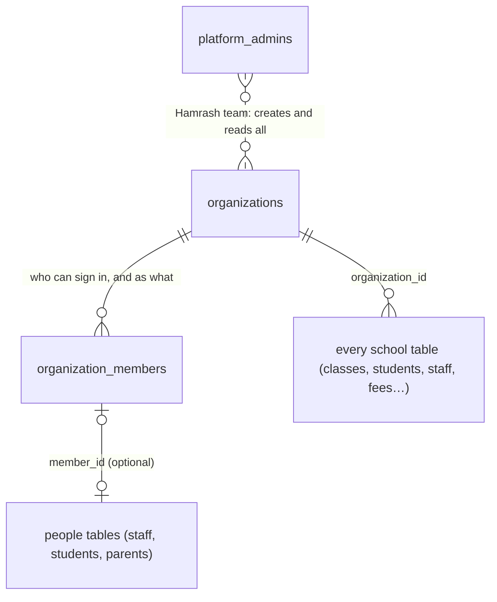

# Organization (Tenant) Schema

> **Status:** applied to the live project on 2026-10-07 (migrations `20261007182933` and `20261007185331`). All 28 checks in [`supabase/tests/01_organizations_access_test.sql`](../supabase/tests/01_organizations_access_test.sql) pass. SQL: [`supabase/migrations/20261007182933_01_create_organizations_and_members.sql`](../supabase/migrations/20261007182933_01_create_organizations_and_members.sql). The live Supabase project (`ccvyhbyrtobdsecqvhcr`) was empty when this was written.

---

## The idea in one sentence

Every school is an **organization**. Every row of school data carries an `organization_id`, and Postgres row-level security only returns rows from organizations the signed-in Clerk user is a member of.



| Layer | Answers | Example |
|-------|---------|---------|
| `organizations` | Which school? | "Kings College", code `HMR-7K2Q9P` |
| `organization_members` | Who can **sign in** to this school, and with what role? | Clerk user `user_2ab…` is a `teacher` at Kings College |
| People tables (next: `staff`, `students`, `parents`) | What does the school **know** about this person? | Name, class, admission number, photo |
| `platform_admins` | Who on the Hamrash team runs the platform? | Support staff who onboard schools |

Membership is kept separate from the people tables because not every person record signs in. A nursery pupil has a `students` row but no membership.

---

## Decisions

| Question | Decision |
|----------|----------|
| Who creates schools? | **Hamrash team**, through `create_organization`. Schools don't sign themselves up. |
| Where do memberships live? | **Postgres** (`organization_members`), not Clerk Organizations |
| Hamrash support access? | **Yes.** `platform_admins` can read every school and create and suspend schools. |
| Short school code? | **Yes:** `HMR-XXXXXX`, generated automatically and unique |
| Campuses? | **Later add-on.** The organization is the only tenant boundary for now. |
| Roles | `owner`, `admin`, `principal`, `vice_principal`, `bursar`, `teacher`, `staff`, `parent`, `student` |

---

## Tables

### `platform_admins`

| Column | Notes |
|--------|-------|
| `clerk_user_id` | PK, Clerk JWT `sub` |
| `full_name`, `email` | |
| `is_active` | Turn off instead of deleting |

Clients can read their own row, so an app can ask "am I a platform admin?". Rows are added in two ways: the **first** admin by hand in the SQL editor, and everyone after that by redeeming a **platform invite code** (see below). Turning someone off (`is_active = false`) is SQL only.

### Platform invite codes *(added in migration 12)*

How a new Hamrash team member joins, used by Hamrash Platform Admin.

| Piece | Notes |
|-------|-------|
| `private.platform_invite_codes` | One row per code: `code_hash` (SHA-256 of the 12-character code), `code_hint` (last 4 characters), `note`, `created_by`, `expires_at` (7 days), `redeemed_by/at`, `revoked_by/at`. The code itself is never stored. |
| `private.platform_invite_attempts` | Wrong-code attempts per Clerk user, for the 5-per-hour limit. Pruned after a day. |
| `create_platform_invite(note)` | Platform admins only. Returns `(invite_id, code, expires_at)`; this is the only time the code is seen. |
| `list_platform_invites()` | Platform admins only. Latest 100 codes with `status`: `pending`, `used`, `expired`, `cancelled`. |
| `revoke_platform_invite(invite_id)` | Platform admins only. Cancels an unused code. |
| `redeem_platform_invite(code, full_name, email)` | Any signed-in user. Valid code → inserts their `platform_admins` row and marks the code used. Wrong, used, cancelled or expired code → returns NULL and records an attempt. Already-active admins get their row back without using the code; turned-off admins are refused. |

Both tables are in `private` (not exposed by the Data API) with RLS on and no grants; only the four security-definer RPCs touch them. Tested by `supabase/tests/07_platform_invites_access_test.sql`.

### `organizations`

| Column | Notes |
|--------|-------|
| `id` | `uuid` PK. The organization id. |
| `code` | `HMR-XXXXXX`, unique, generated |
| `name`, `email`, `phone`, `address`, `state`, `logo_url` | Editable by the school's owner or admin |
| `logo_id` | Cloudflare Images id of the logo, needed to replace or delete it. Editable by the owner or admin. *(added in migration 03)* |
| `number_prefix` | Required, 2–8 letters or digits (e.g. `KCL`). Entered by Hamrash at creation; goes in front of admission and staff numbers. Owner or admin can correct it. *(added in migration 03)* |
| `status` | `trial`, `active`, `suspended`, `archived`. Only platform admins change it. Schools are never deleted. |
| `created_by` | Clerk id of the platform admin who created it |

### `organization_members`

| Column | Notes |
|--------|-------|
| `id` | `uuid` PK |
| `organization_id` | FK → `organizations`, `ON DELETE RESTRICT` |
| `clerk_user_id` | `null` until the invite is claimed |
| `role` | `member_role` |
| `status` | `invited` → `active` → `suspended` |
| `claim_code` | 8 chars, generated on invite, cleared once redeemed. Shown to users as `XXXX-XXXX`. |
| `invited_by`, `joined_at` | |

- One row per (school, person, role). A teacher who is also a parent at the same school has two rows. Someone at two schools has rows in both.
- `unique (organization_id, id)` lets the people tables point at a membership with a composite FK, so a membership can't be attached to the wrong school.

---

## How a school is onboarded

```
Hamrash platform admin              School owner                      Owner's staff
──────────────────────              ────────────                      ─────────────
create_organization("Kings College", "KCL")
  → org created (code HMR-7K2Q9P, status trial)
  → owner invite created (claim code ABCD-2345)
gives the code to the owner  ──►    signs in with Clerk
                                    redeem_claim_code("ABCD-2345", first, last, email, phone)
                                      → membership active, role owner
                                      → owner's staff record created (STF/0001)
                                    invites admins/teachers  ──►      sign in, redeem their codes
```

**The owner's staff record.** Redeeming an owner code also creates the owner's `staff` record (job title `Owner`, non-teaching) and links it to the membership, so the owner has a staff number and appears in the staff list. The app passes the name, email and phone from the Clerk profile. A name is required for owner codes only, and only when the person has no staff record at the school yet: a teacher who is made a co-owner keeps their one record. Codes issued by `invite_staff`, `invite_student` and `invite_parent` already point at a record, so they need only the code. *(added in migration 11)*

### Checking a code first *(added in migration 13)*

Apps look a code up with `check_claim_code(code)` before redeeming it. Checking never uses the code. It returns one row:

| Column | Notes |
|--------|-------|
| `status` | `ok`, `not_found` (wrong or used), `locked` (too many wrong codes), `school_inactive`, `already_member` |
| `organization_id`, `school_name`, `school_code`, `school_address`, `school_state`, `school_logo_url` | Filled in unless `not_found` or `locked`, so the person can confirm the school |
| `role`, `app` | `app` is the app that role signs in to: `admin` (owner, admin, principal, vice principal, bursar), `staff` (teacher, staff), `family` (parent, student). Hamrash Admin turns away anything but `admin`, and the code stays usable in the right app. |
| `needs_name` | `true` for an owner code that will create the owner's staff record, so the app knows to ask for a name |
| `tries_left`, `retry_at` | Wrong codes left this hour; when a `locked` account can try again |

**Wrong-code limit.** 5 wrong codes per account per hour, counted across `check_claim_code` and `redeem_claim_code` in `private.claim_code_attempts`. The lock lifts an hour after the 5th most recent wrong try. Half-typed codes (not 8 letters or numbers) don't count, and a successful redeem clears the count. Since migration 13, `redeem_claim_code` returns NULL for a wrong or used code instead of raising, so the attempt is kept; while locked it raises "Too many wrong codes. Try again in N minutes." Tested by `supabase/tests/08_check_claim_code_test.sql`.

Later, `set_organization_status(org, 'active' | 'suspended' | 'archived')` is platform-admin only.

**What suspension does.** Members of a suspended or archived school can still see their membership and the school's row, so the app can show "this school is suspended, contact Hamrash". All other school data is hidden, and claim codes for that school stop working.

---

## How access control works

Two helpers in a `private` schema, which the Data API doesn't expose:

- `private.my_org_ids(roles)`: the schools where the caller is an **active member** and the school is **active or trial**, optionally limited to certain roles.
- `private.is_platform_admin()`: whether the caller is an active Hamrash platform admin.

Every policy is built from them:

```sql
-- members of the school (and Hamrash support) can read
using (organization_id in (select private.my_org_ids()) or (select private.is_platform_admin()))

-- only the school's owners and admins can write
with check (organization_id in (select private.my_org_ids(array['owner','admin']::public.member_role[])))
```

- **`in (select …)` runs once per query, not per row**, then uses the `organization_id` index.
- **Both helpers are `security definer`**, so policies on the tables they read don't recurse. They only ever look up the caller's own JWT `sub`.

### Who can do what (core tables)

| Action | Owner | Admin | Principal / VP | Other members | Platform admin |
|--------|:-----:|:-----:|:--------------:|:-------------:|:--------------:|
| Read own school | ✓ | ✓ | ✓ | ✓ | ✓ (all schools) |
| Edit school details | ✓ | ✓ | | | ✓ |
| Change school status | | | | | ✓ (RPC) |
| See all members of the school | ✓ | ✓ | ✓ | own rows only | ✓ |
| Invite members (not owners) | ✓ | ✓ | | | ✓ |
| Invite owners | | | | | ✓ |
| Change role or status of members | ✓ | ✓ | | | ✓ |
| Change or remove an owner | ✓ | | | | ✓ |
| Delete unclaimed invites | ✓ | ✓ | | | ✓ |

**Guards enforced by the database:**
- An admin can't promote anyone, including themselves, to owner, and can't demote or suspend an owner.
- A school can never lose its last active owner.
- Clients can never write `status`/`code` on schools, or `clerk_user_id`/`claim_code` on members. Column-level grants block it, and only the RPCs set them.
- An `active` member must have a Clerk id, and an `invited` member must have a claim code.

---

## Rules every future school table follows

```
[ ] organization_id uuid not null references organizations(id) on delete restrict
[ ] unique (organization_id, id)  ← lets child tables use composite FKs
[ ] FKs to other school tables are composite: (organization_id, x_id) → x(organization_id, id)
[ ] indexes lead with organization_id
[ ] RLS enabled; policies use private.my_org_ids(...) and include platform-admin read
[ ] revoke all from anon, authenticated; then grant only what's needed
    (this project's defaults grant ALL to anon/authenticated on new tables)
[ ] update policies have both USING and WITH CHECK; organization_id is never client-updatable
```

"Members can read" suits school-wide reference data (classes, subjects, timetable, announcements). People and finance tables need narrower rules, for example a parent sees only their own children. We design those table by table.

---

## Prerequisites to check

- The Supabase project has the **Clerk third-party auth integration** enabled (Dashboard → Authentication → Third-party).
- Clerk session tokens include `"role": "authenticated"`, otherwise Supabase treats requests as `anon`.
- After applying, the **first** platform admin is added by hand in the SQL editor (everyone after that joins with a platform invite code from Hamrash Platform Admin):
  ```sql
  insert into public.platform_admins (clerk_user_id, full_name, email)
  values ('<your Clerk user id>', '<name>', '<email>');
  ```

## Open work

Open work for this area is tracked in [TODO.md](../TODO.md).
